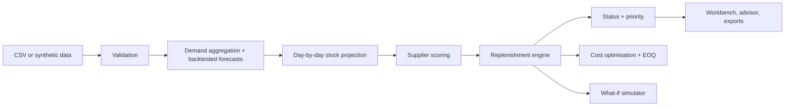

# RESTOCK AI: Retail Inventory Replenishment Intelligence
Never run out. Never overstock.

Forecasts SKU demand, calculates safety stock and reorder points, compares suppliers, flags stockout and overstock risk, and builds validated proposed purchase orders. Bundled data is **fictional synthetic data**: 108 SKUs, 6 categories, 7 suppliers, 3 stores, 13 months of daily sales, with planted stockout-prone fast movers, overstocked slow movers and an unreliable supplier.

## How RESTOCK AI works: the 10-step algorithm
1. **Load and validate.** Read sales, product master, inventory, suppliers, incoming POs and costs (or the synthetic demo); reject missing, negative, duplicate, unknown-SKU and invalid values with row references; never silently fill gaps.
2. **Aggregate demand.** Sum store-level sales into daily SKU demand on a full calendar (days without rows become documented zeros).
3. **Backtest forecasters.** Hold out the last 28 days (chronological) and score seasonal naive, 28-day moving average, Holt-Winters and gradient boosting by WAPE, MAE and RMSE.
4. **Forecast.** Pick the lowest-error method per SKU (baseline if history is short) and forecast 7, 14, 30 and 90 days.
5. **Project stock.** Roll available stock forward day by day, adding incoming orders only on their arrival dates, to find stockout days and shortage within the lead time.
6. **Choose suppliers.** Score every offer on cost, speed (lead time plus variability) and reliability, with speed weighted more for urgent SKUs; never just the cheapest.
7. **Calculate policy.** Safety stock = z·√(L·σ²+d²·σL²); reorder point = lead-time demand + safety stock; position = on hand + incoming − allocated; order = target − position, rounded to case pack and MOQ.
8. **Classify and prioritise.** Critical, Stockout Risk, Reorder Now, Reorder Soon, Healthy, Overstocked, Slow Moving, ranked by risk, demand, lead time, importance and financial exposure.
9. **Optimise cost.** EOQ where demand is steady, ordering vs holding costs, working capital and service-level trade-offs; build and validate a proposed purchase order.
10. **Stress-test and report.** Seeded day-by-day what-if simulation (demand, delays, costs, disruptions, promotions) with common random numbers; exports and an executive summary for human review.

## Architecture


## Run
```
pip install -r requirements.txt
python app.py
```
In Google Colab paste `app.py` into one cell and run it; Gradio prints a public link. See the Methodology tab for formulas.

## Sample schema
`sales_history.csv` (date, sku, store, units, promo); `product_master.csv` (sku, product_name, category, unit_cost, unit_price, importance); `current_inventory.csv` (sku, location, on_hand, allocated); `supplier_info.csv` (supplier_id, supplier_name, sku, lead_time_days, lead_time_sd, moq, case_pack, unit_cost, on_time_rate); `incoming_purchase_orders.csv` (po_id, sku, supplier_id, qty, expected_date); `product_costs.csv` (sku, ordering_cost, holding_pct). Currency ₹.

## Testing, limits, responsible use
`pip install pytest && pytest tests` runs the built-in self-tests. Estimates are not guarantees; buyers must review every recommendation. Nothing is sent to suppliers. Add screenshots to `screenshots/` (none included).
